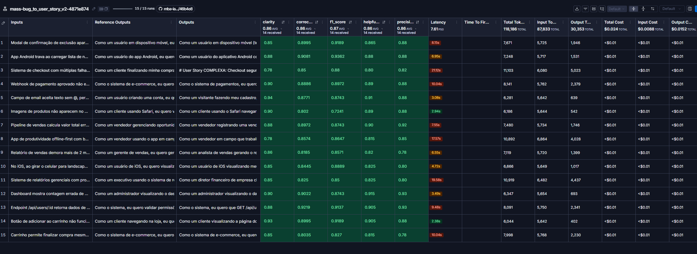

# Resultados Finais

**Contexto:** `src/evaluate.py` roda o prompt `mass/bug_to_user_story_v2` nos 15 exemplos do dataset e calcula 5 métricas com um LLM avaliador. Para ser aprovado, a média de cada métrica precisa ser ≥ 0.8.

- Provider: Anthropic ([adicionado ao projeto](como-executar.md#provider-anthropic-adicionado-nesta-entrega))
- Modelo que gera: `claude-haiku-5-5`
- Modelo que avalia: `claude-sonnet-5-5`
- Experimento: `mass-bug_to_user_story_v2-4871e874`

| Métrica | Nota |
|---|---|
| Helpfulness | 0.86 ✓ |
| Correctness | 0.87 ✓ |
| F1-Score | 0.87 ✓ |
| Clarity | 0.87 ✓ |
| Precision | 0.86 ✓ |
| **Média geral** | **0.8663** ✅ APROVADO |

## Evidências no LangSmith

- **Link público do dataset (15 exemplos + experimentos + tracing):** <https://smith.langchain.com/public/468d13c6-7e77-41e0-af63-8dec037ca755/d>
- **Prompt público no LangSmith Hub:** <https://smith.langchain.com/hub/mass/bug_to_user_story_v2>
- Screenshot do experimento:

## v1 x v2

| | v1 | v2 |
|---|---|---|
| Instrução | "crie uma user story a partir dele" | Papel, passo a passo e formato por nível de complexidade |
| Formato | Não definido | Esqueleto SIMPLES / MÉDIO / COMPLEXO |
| Exemplos | Nenhum | 3 (um por nível) |
| Critérios de aceitação | Não pedidos | Dado/Quando/Então, com números, códigos HTTP e mensagens |
| Regras | Nenhuma | Fidelidade ao relato, cobertura, concisão e proteção contra instruções embutidas no relato |
| Entrada | `{bug_report}` repetido no system e no user | Relato só no user prompt |

**Por quê:** as métricas comparam a resposta com um gabarito de formato fixo. A v1 não dava ao modelo nem esse formato nem o nível de detalhe esperado.

## Iterações

| Iteração | F1 | Clarity | Precision | Status |
|---|---|---|---|---|
| 1 (`298472a8`) | **0.75** | 0.85 | 0.87 | ❌ |
| 2 (`4871e874`) | 0.87 | 0.87 | 0.86 | ✅ |

**Problema da iteração 1:** os comentários dos juízes mostraram que faltava conteúdo, não que havia invenção. O gabarito espera metas e boas práticas que o relato não traz (ex.: "carregar em < 2 s", "confirmação **e** contador", "reserva de estoque de 15 min"). A regra antiga "não invente números" impedia o modelo de incluí-las.

**Correções na iteração 2:**

1. Metas de qualidade ausentes no relato agora são definidas com valores de mercado. Fatos do incidente continuam proibidos de inventar.
2. Checklist por tipo de bug.
3. Classificação pela estrutura do relato: passos numerados de um único fluxo contam como MÉDIO.
4. Regras de concisão: sem repetir critérios no contexto, sem "não informado", sem "ou" nos critérios.
